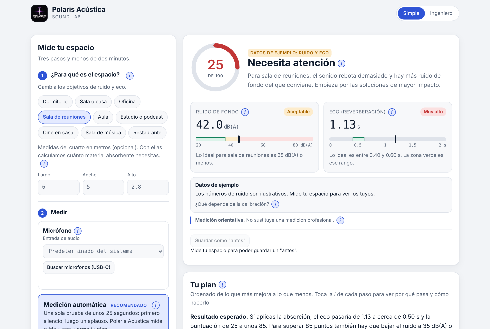
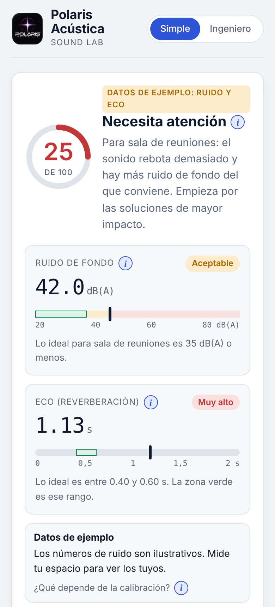
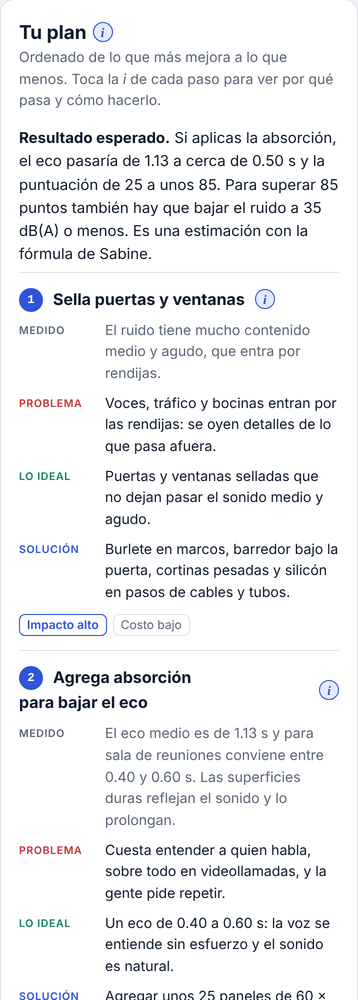
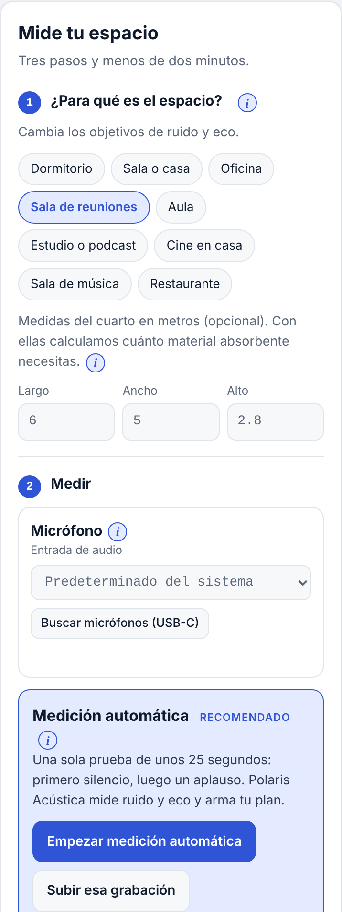
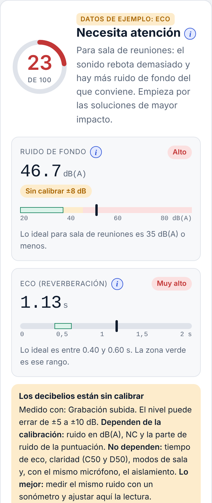
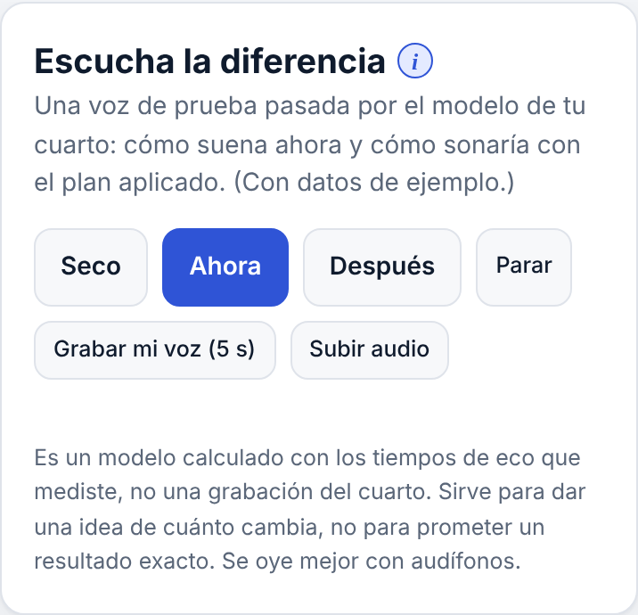
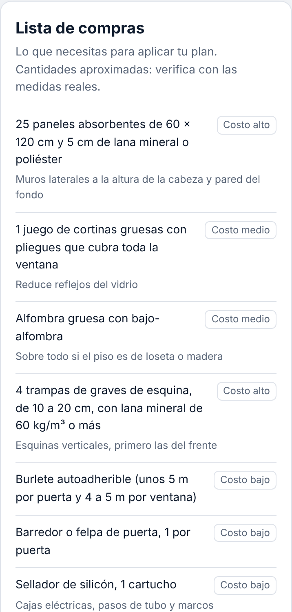
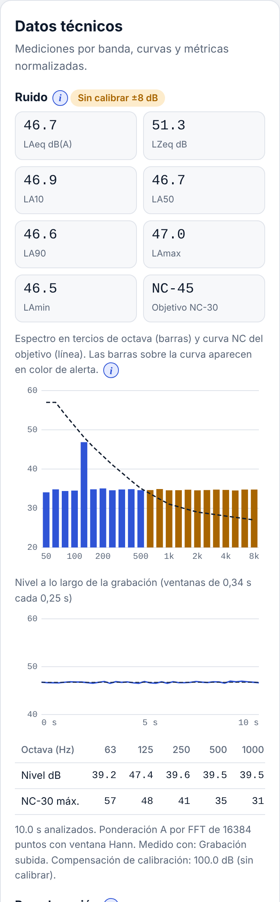
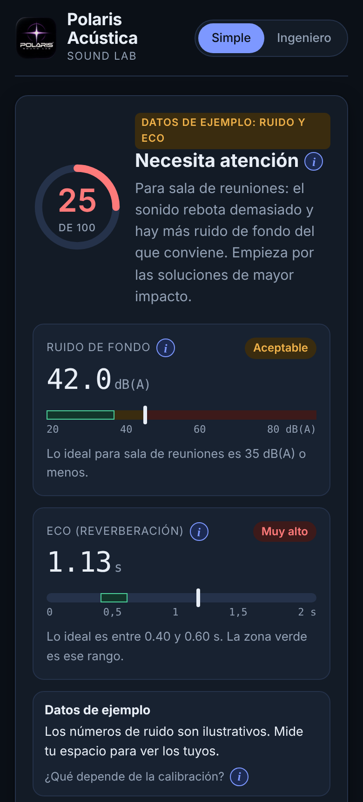

# Polaris Acústica

**Mide el ruido y el eco de un espacio con tu teléfono y recibe un plan claro para que suene mejor.** Hecha por [Polaris Sound Lab](https://instagram.com/polaris.sound.lab) · Mérida, Yucatán, México · @polaris.sound.lab

> Las capturas usan datos de ejemplo.

## Pruébala ahora

- **En el navegador (iPhone, Android y computadora):** https://drophlex.github.io/polaris-acustica/
- **Android (APK de prueba):** descárgalo en [Releases](../../releases). Es una versión de prueba, no de Google Play.
- **Instalarla como app:** en iPhone, Safari > Compartir > *Agregar a pantalla de inicio*. En Android, Chrome > menú > *Instalar app*.

## ¿Qué es?

Una app que escucha tu espacio durante menos de un minuto (un momento de silencio y un aplauso) y te dice, en palabras sencillas:

1. cuánto **ruido de fondo** hay,
2. cuánto **eco** (reverberación) tiene el cuarto,
3. si eso es **adecuado para lo que haces ahí**, y
4. **qué hacer, en qué orden y con qué materiales** para mejorarlo.

Cada hallazgo se explica en cuatro partes: **Medido · Problema · Lo ideal · Solución**. Hay modo **Simple** para quien no sabe de acústica y modo **Ingeniero** con curvas, bandas y métricas.

## ¿A quién le sirve?

| Si eres… | Te ayuda a… |
|---|---|
| Alguien que trabaja o estudia en casa | Entender por qué cuesta concentrarse o por qué en videollamadas te piden repetir |
| Dueño de una sala de juntas u oficina | Saber si el cuarto rebota demasiado y cuánto material absorbente necesitas |
| Podcaster, streamer o creador de contenido | Revisar tu cuarto de grabación antes de comprar equipo caro |
| Músico o profesor de música | Mejorar el cuarto de ensayo o de clases |
| Docente | Revisar si los alumnos del fondo entienden |
| Dueño de un restaurante o local | Detectar si el eco hace que todos tengan que gritar |
| Quien arma un cine en casa | Aclarar diálogos y controlar el rebote |
| Quien duerme mal por ruido | Medir el fondo del dormitorio y ver qué sellar |
| Instalador o técnico | Tener una primera lectura rápida antes de una medición formal |

## Guía para principiantes (sin saber nada de acústica)

**Conceptos en palabras simples**

| Palabra | Qué significa |
|---|---|
| **Ruido de fondo** | El sonido que hay cuando "no hay nada": aire acondicionado, tráfico, zumbidos. Se mide en decibelios (dB). |
| **Eco / reverberación** | Cuánto tarda en apagarse un sonido en el cuarto. Cuarto vacío con paredes duras = mucho eco. |
| **Claridad (C50, D50)** | Qué tan fácil se entiende una voz. Más alto = se entiende mejor. |
| **Calibrar** | Enseñarle a la app cuántos decibelios reales mide tu micrófono, comparando con un sonómetro. |
| **Absorción** | Materiales blandos (cortinas, alfombras, paneles) que "se tragan" el sonido y reducen el eco. |

**Tu primera medición en 5 minutos**

1. Abre la app en tu teléfono o computadora. Cuando pida permiso para el micrófono, pulsa *Permitir*.
2. Entra al cuarto que quieres revisar, cierra la puerta y ponte donde normalmente te sientas o hablas.
3. Elige para qué usas el cuarto (por ejemplo "Oficina" o "Estudio de grabación").
4. Pulsa *Empezar medición automática*. Quédate en silencio unos 15 segundos. Cuando la app lo indique, **da un aplauso fuerte**.
5. Lee el veredicto y el plan. Empieza por el primer paso: normalmente es lo más barato y lo que más ayuda.
6. Aplica el cambio, vuelve a medir y compara.

**Lo que debes saber antes de confiar en los números**
- Los **tiempos de eco y la claridad** son confiables aunque no calibres.
- Los **decibelios** son una estimación hasta que calibres tu micrófono.
- Si el aplauso sale débil o hay ruido, la app te lo indica: repite la medición.

**Preguntas frecuentes**

- *¿Necesito un micrófono especial?* No. Funciona con el del teléfono. Uno externo USB-C puede dar mejores resultados.
- *¿Se graba o se sube mi audio?* No. Todo se procesa en tu dispositivo.
- *¿Sustituye a un especialista?* No. Es una primera guía, no una medición certificada.
- *No me deja usar el micrófono.* Revisa los permisos del navegador. El micrófono solo funciona en páginas con `https`.

## Gratis y Pro

Medir es **siempre gratis y sin límite**. Tu **primera medición real incluye todo Pro durante 24 horas** para que pruebes la herramienta completa. Después, la app sigue funcionando, con estas diferencias:

| | Gratis | Pro (149 MXN, pago único) |
|---|---|---|
| Medir ruido, eco, claridad y aislamiento | ✅ | ✅ |
| Veredicto y puntuación | ✅ | ✅ |
| Plan de mejora | Los 3 primeros pasos | Completo |
| Lista de compras | Los 3 primeros artículos | Completa |
| Escucha la diferencia y modo Ingeniero | ✅ | ✅ |
| Copiar informe y exportar CSV | ✅ (informe con 3 pasos) | ✅ completo |
| Proyectos guardados y comparación de dos espacios | — | ✅ |
| Informe en PDF con tu nombre o empresa y el logo | — | ✅ |

**Cómo se obtiene Pro:** paga 149 MXN por PayPal desde la propia app, escríbeme y te envío tu código personal (lo entrego a mano, normalmente el mismo día). El código se pega en la app y funciona en cualquier dispositivo.

**Transparencia:** el código se comprueba dentro de la app, sin servidor, así que técnicamente podría saltarse editando el código. Es una forma de apoyar el proyecto. La prueba de 24 horas se guarda en tu dispositivo.

**¿Quieres que revise tu espacio?** Desde la app puedes enviarme tu informe por correo y platicamos qué conviene hacer. Es una orientación, no una medición profesional.

## ¿Qué problemas resuelve?

| Problema que notas | Lo que mide la app | Lo que te sugiere |
|---|---|---|
| "Se oye como en una cueva" | Tiempo de reverberación por banda | Cuántos paneles, cortinas o alfombra, y dónde ponerlos |
| "Cuesta entender a quien habla" | Claridad (C50 y D50) | Absorción en los primeros puntos de reflexión |
| "Retumban los graves" | Reverberación en graves | Trampas de esquina |
| "Hay un zumbido todo el día" | Espectro del ruido y tonos puros | Dónde buscar la fuente y cómo aislarla |
| "Se oye lo de al lado" | Aislamiento entre dos cuartos | Sellado, masa y desacople |
| "Suena un tin-tin-tin al aplaudir" | Eco repetitivo entre paredes paralelas | Absorber o romper el paralelismo |
| "No sé qué comprar" | Plan por impacto y costo | Lista de compras con cantidades aproximadas |

## Casos ideales

- Primer diagnóstico de un cuarto **antes de gastar** en tratamiento acústico.
- Comparar **antes y después** de una mejora (la app guarda la medición previa).
- **Escuchar la diferencia** antes de comprar: una voz de prueba pasada por el modelo de tu cuarto, ahora y con el plan aplicado.
- Explicarle a un cliente, compañero o familiar **por qué** hay que mejorar el espacio.

## Cuándo no es suficiente

Para certificaciones, normativas, contratos, conflictos legales, estudios profesionales o salas críticas contrata una medición profesional con equipo certificado. **Esta medición es orientativa y no la sustituye.**

## Capturas

| Resultado | Plan: problema, ideal y solución |
|---|---|
|  |  |

| Medir (micrófono USB-C incluido) | Aviso de calibración |
|---|---|
|  |  |

| Escucha la diferencia | Lista de compras |
|---|---|
|  |  |

| Modo Ingeniero | Modo oscuro |
|---|---|
|  |  |

## Instructivo

1. **Elige para qué es el espacio.** Dormitorio, sala, oficina, sala de juntas, aula, estudio, cine en casa, sala de música o restaurante. Cada uso tiene sus propios objetivos. Si quieres, escribe largo, ancho y alto del cuarto para calcular cuánto material necesitas.
2. **Elige el micrófono.** Si conectas uno por USB-C, pulsa *Buscar micrófonos* y elígelo. Verifica en el resultado el nombre del micrófono con el que se midió.
3. **Pulsa *Empezar medición automática*.** Quédate en silencio unos 15 segundos y, cuando la app lo indique, da un aplauso fuerte. Si hace falta, repite. También puedes subir una grabación o medir por separado el ruido, el aplauso, el barrido, o el aislamiento entre dos cuartos (en *Medidas avanzadas*).
4. **Lee el veredicto.** Te dice qué tan bien está el espacio para tu uso y qué hacer primero.
5. **Sigue el plan.** Toca la *i* de cada paso para ver por qué pasa, cómo hacerlo y cómo comprobarlo. Revisa la lista de compras.
6. **Mide otra vez** y compara con la medición anterior.
7. **Calibra tu micrófono** (recomendado, ver abajo) para confiar en los decibelios.

### Calibración: cómo confiar en los decibelios

Un micrófono de teléfono no sabe cuántos decibelios mide. Sin calibrar, el nivel puede errar de ±5 a ±10 dB. La mejor forma de calibrarlo:

1. Pon un **sonómetro** junto al micrófono.
2. Genera un ruido constante de 65 a 80 dB(A) (un ventilador o ruido rosa).
3. Mide 15 segundos con la app y anota la lectura (LAeq) del sonómetro.
4. En *Calibración del micrófono*, escribe esa lectura y pulsa *Calibrar con la lectura*.

Cada micrófono se calibra por separado y la calibración vale mientras no cambies su ganancia. **No dependen de la calibración:** tiempo de eco, claridad (C50 y D50), modos de sala y el aislamiento (con el mismo micrófono).

## Funciones

- Medición automática (silencio + aplauso) y medición manual.
- Selector de micrófono y soporte para micrófonos externos por USB-C.
- Calibración por micrófono y avisos en los resultados cuando no está calibrado.
- Ruido: LAeq, LZeq, LA10/50/90, máximos y mínimos, espectro en tercios de octava y curva NC.
- Eco por bandas (EDT, T20, T30), claridad C50, detección de eco repetitivo y medición con barrido.
- Aislamiento entre dos cuartos.
- Plan por impacto y costo, con explicación en cada paso y lista de compras (completos en Pro).
- Comparación antes y después, y escucha de la diferencia.
- Informe para copiar y exportación CSV.
- **Pro:** proyectos guardados, comparación de espacios e informe en PDF con tu marca.
- Funciona sin internet después de la primera vez. Modo claro y oscuro.

## Precisión y límites

- El nivel en decibelios depende de la calibración. Sin calibrar es una estimación.
- Los objetivos por uso y las curvas NC son orientativos y aún no se han verificado contra las normas.
- No se ha validado contra un sonómetro certificado ni probado en todos los teléfonos. En iPhone el sistema puede procesar el audio del micrófono y elegir micrófonos USB es más limitado que en Android.
- La bocina de un teléfono casi no reproduce graves: para el barrido usa una bocina externa.
- El plan es una guía, no un proyecto acústico.

## Privacidad

Todo el análisis ocurre en tu dispositivo. El audio **no se envía a ningún servidor**. La página solo descarga las tipografías desde Google Fonts.

## ¿Quieres modificarla o proponer cambios?

El código se publica para que lo puedas consultar, pero **solo el responsable puede modificarlo** (ver [LICENSE](LICENSE)). Si tienes una idea o quieres colaborar, [abre una propuesta](../../issues/new/choose) o escríbeme. Si me convence, te doy acceso para que trabajes en el código. Detalles en [CONTRIBUTING.md](CONTRIBUTING.md).

## ¿Te gusta la app? ¿Tienes sugerencias?

Las leo todas: **drophlex@gmail.com**. Si te sirvió mi trabajo, [invítame un café](https://www.paypal.com/donate?business=drophlex%40gmail.com&currency_code=USD&item_name=Caf%C3%A9%20para%20Polaris%20Sound%20Lab) (PayPal: drophlex@gmail.com).

## Créditos

© 2026 Polaris Sound Lab · Mérida, Yucatán, México · @polaris.sound.lab
